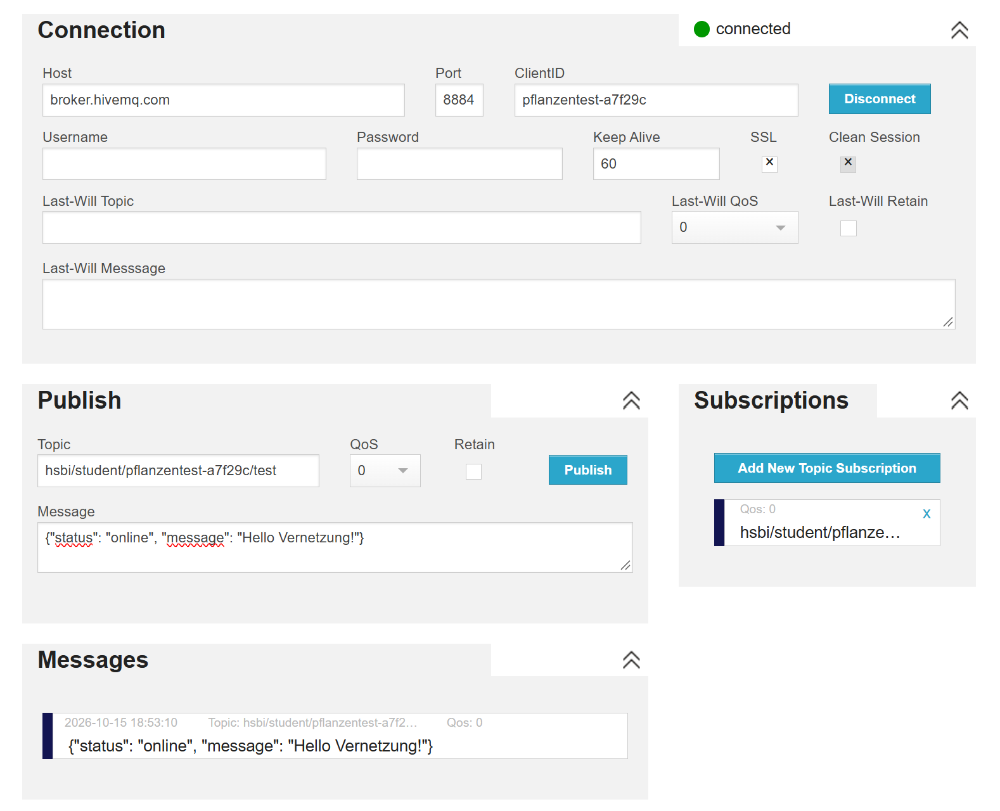

# Modul 0 – Vorbereitung: Vernetzung und IoT-Lösungen

Beginn: 15.10.2026

Status: In Bearbeitung

## 1. Portfolio einrichten

- [x] Persönliches GitHub-Repository aus der Kursvorlage erstellt.
- [x] Repository auf den Laptop geklont.
- [x] Diesen Vorbereitungseintrag angelegt.
- [x] Vorbereitung bearbeitet und Ergebnisse dokumentiert.
- [x] Notizen und Belege mit Git gespeichert und zu GitHub hochgeladen.

## 2. Inspiration – Schritt A

Video: [Teaching the IoTempower Way](https://video.iotempower.us/)

- [x] Video angesehen.

### Was finde ich spannend?

Mich spricht an, dass man mit erschwinglicher Hardware Lösungen für alltägliche Probleme entwickeln kann. Besonders interessant finde ich das intelligente Pflanzgefäß, weil es Menschen mit wenig Platz oder Erfahrung beim Anbau eigener Pflanzen unterstützen kann.

### Leitfrage 1: Meine IoT-Idee

**Welche vernetzte Anwendung würde ich selbst gern bauen?**

Ich würde gern eine Pflanzenüberwachung bauen, die die Bodenfeuchtigkeit misst und anzeigt, wann die Pflanze Wasser braucht. Als Erweiterung könnte das System die Pflanze automatisch bewässern.

**Wer würde sie nutzen, und welche Geräte müssten miteinander kommunizieren?**

Die Anwendung wäre beispielsweise für Studierende im Wohnheim oder Menschen mit Zimmerpflanzen hilfreich. Ein Bodenfeuchtigkeitssensor würde seine Messwerte an einen kleinen Computer wie den ESP32 liefern. Dieser würde die Werte über WLAN und MQTT an eine Anzeige auf dem Laptop oder einem Display senden. Für eine automatische Bewässerung könnte zusätzlich eine steuerbare Wasserpumpe eingebunden werden.

## 3. Netzwerkgrundlagen – Schritt B

Quelle: [How Data Moves Through the Internet – Ed Harmoush](https://www.practicalnetworking.net/index/networking-fundamentals-how-data-moves-through-the-internet/)

Pflichtlektionen:

- [ ] 1a: Hosts, IP Addresses, Networks.
- [ ] 1b: Repeaters, Hubs, Bridges, Switches, Routers.
- [ ] 2a: OSI Model – Layers 1, 2, 3.

Zusätzlich empfohlen: 2b sowie 3a und 3b.

### Notizen zu Lektion 1a: Hosts, IP-Adressen und Netzwerke

Grundlage: bereitgestelltes Transkript. Die folgenden Notizen fassen die Inhalte zusammen; die Video-Checkliste oben bleibt separat.

- Ein **Host** ist ein Gerät, das Daten sendet oder empfängt, beispielsweise ein Laptop, Smartphone oder vernetztes IoT-Gerät.
- **Client und Server sind Rollen innerhalb einer Kommunikation:** Der Client stellt eine Anfrage, der Server beantwortet sie. Derselbe Computer kann in unterschiedlichen Verbindungen beide Rollen übernehmen.
- Ein Server braucht keine besondere Hardware. Ein Computer wird durch passende Software beispielsweise zum Webserver.
- Eine **IP-Adresse** dient der Adressierung im IP-Netzwerk. IP-Pakete enthalten eine Quelladresse und eine Zieladresse. Genauer werden IP-Adressen Netzwerkschnittstellen zugewiesen; ein Gerät kann mehrere haben.
- Die im Video beschriebenen **IPv4-Adressen** bestehen aus 32 Bits, aufgeteilt in vier Gruppen zu je acht Bits. Deshalb hat die Schreibweise vier Zahlen zwischen 0 und 255, beispielsweise `192.168.1.20`. IPv6 verwendet dagegen 128 Bits.
- Ein **Netzwerk** verbindet Geräte, damit sie Daten austauschen können. Größere Adressbereiche können durch Subnetting in kleinere Subnetze aufgeteilt werden.
- Wie groß ein Subnetz ist, bestimmt die Subnetzmaske beziehungsweise Präfixlänge. Gleiche erste drei Zahlen bedeuten nicht ohne Angabe der Maske automatisch dasselbe Subnetz.
- Das **Internet** verbindet viele eigenständige Netzwerke miteinander.

Bezug zur Pflanzenüberwachung: Der ESP32 und der Laptop sind Hosts. Bei MQTT verbinden sich beide als Clients mit dem Broker, der die Serverrolle übernimmt. Auch der veröffentlichende Sensor ist dabei ein MQTT-Client.

### Notizen zu Lektion 1b: Netzwerkgeräte

Grundlage: bereitgestelltes Transkript, mit ergänzenden Präzisierungen.

| Gerät | Aufgabe |
|---|---|
| Repeater | Regeneriert Signale, um größere Entfernungen zu überbrücken. |
| Hub | Wiederholt eingehende Signale an allen anderen Ports; entscheidet nicht anhand des Empfängers. |
| Bridge | Verbindet Netzwerksegmente und lernt anhand von MAC-Adressen, auf welcher Seite Geräte erreichbar sind. Das Video zeigt eine Bridge mit zwei Ports; Bridges sind nicht grundsätzlich auf zwei Ports beschränkt. |
| Switch | Arbeitet wie eine Bridge mit mehreren Ports. Leitet bekannte Unicast-Ziele gezielt an den passenden Port weiter. Broadcasts und unbekannte Unicast-Ziele werden innerhalb des jeweiligen VLANs an die anderen geeigneten Ports verteilt. |
| Router | Leitet IP-Pakete zwischen unterschiedlichen IP-Netzen weiter und wählt dafür anhand seiner Routingtabelle den nächsten Weg. |

- **Switching** ermöglicht Kommunikation innerhalb eines lokalen Netzwerks; **Routing** verbindet unterschiedliche IP-Netze.
- Ein gewöhnlicher Layer-2-Switch trifft seine Weiterleitungsentscheidung anhand von MAC-Adressen, nicht anhand von IP-Adressen.
- Mehrere Geräte am selben Switch sind nicht zwangsläufig im selben IP-Subnetz: VLANs und die IP-Konfiguration müssen berücksichtigt werden.
- Das **Standardgateway** ist für einen Host die nächste Anlaufstelle für Ziele, für die keine spezifischere Route gilt, insbesondere außerhalb seines lokalen Subnetzes. Zu Hause ist das meist die lokale IP-Adresse des Routers.
- Die **Routingtabelle** enthält bekannte Zielnetze und Informationen darüber, über welche Schnittstelle beziehungsweise welchen nächsten Router sie erreichbar sind.
- Router bilden geeignete Übergänge für Filterregeln. Welche Verbindungen tatsächlich erlaubt sind, hängt von der Konfiguration ab.
- Ein Heimrouter vereint häufig mehrere Funktionen: Router, Switch, WLAN-Zugangspunkt und Firewall.

Bezug zur Pflanzenüberwachung: Liegen ESP32 und MQTT-Broker im selben lokalen Subnetz, muss ihr Datenverkehr nicht über die Routingfunktion ins Internet. Liegt der Broker in einem anderen Netz, wird der Verkehr über einen Router weitergeleitet.

### Notizen zu Lektion 2a: OSI-Modell – Schichten 1 bis 3

Grundlage: bereitgestelltes Transkript, mit ergänzenden Präzisierungen. Das OSI-Modell ordnet Kommunikationsaufgaben sieben Schichten zu. Diese Lektion behandelt die ersten drei.

| Schicht | Aufgabe | Beispiele und Adressen |
|---|---|---|
| 1 – Bitübertragung (Physical) | Überträgt Bits als elektrische, optische oder Funksignale. | Kabel, Funkübertragung, Repeater, Hub. |
| 2 – Sicherung (Data Link) | Überträgt Datenrahmen innerhalb des jeweiligen lokalen Verbindungsabschnitts. | Ethernet-/WLAN-Rahmen, MAC-Adressen, Bridge, Layer-2-Switch. |
| 3 – Vermittlung (Network) | Adressiert Pakete und ermöglicht ihre Weiterleitung über Netzgrenzen hinweg. | IP-Adressen, IP-Pakete, Router. |

- **MAC-Adresse:** Adresse auf Schicht 2, bei Ethernet und WLAN normalerweise 48 Bits, beispielsweise `02:11:22:33:44:55`. MAC-Adressen können geändert oder zufällig erzeugt werden; sie sind keine unveränderliche Geräteidentität.
- **IP-Adresse:** Adresse auf Schicht 3. Sie beschreibt die Erreichbarkeit einer Netzwerkschnittstelle im IP-Netz. Die 32 Bits im Video beziehen sich auf IPv4; IPv6 verwendet 128 Bits.
- **Warum beide?** Die Ziel-IP bezeichnet das Ziel des IP-Pakets. Die Ziel-MAC bezeichnet im jeweiligen lokalen Abschnitt den nächsten Empfänger: entweder das Zielgerät selbst oder einen nächsten Router.
- Bei einer Weiterleitung über einen Router wird die eingehende Schicht-2-Verpackung entfernt und eine passende Verpackung für den nächsten Verbindungsabschnitt erzeugt. Ein gewöhnlicher Switch ersetzt dabei nicht an jedem Port die Quell- und Ziel-MAC.
- Ohne Adressübersetzung (NAT) bleiben Quell- und Ziel-IP beim gewöhnlichen Routing gleich. Andere IP-Headerfelder ändern sich trotzdem, beispielsweise die verbleibende Lebensdauer (TTL). IP allein garantiert keine Zustellung.
- **Header** sind zusätzliche Steuerinformationen vor den Nutzdaten, beispielsweise Quell- und Zieladressen. Das Verpacken von Daten in die Strukturen der unteren Schichten heißt Kapselung.
- **ARP** ermittelt im lokalen IPv4-Netz die MAC-Adresse zu einer IPv4-Adresse. Für ein entferntes Ziel wird normalerweise die MAC-Adresse des nächsten Routers ermittelt. IPv6 verwendet dafür Neighbor Discovery.
- Präzisierung zum Video: WLAN umfasst sowohl Schicht 1 als auch Schicht 2. Netzwerkschnittstellen setzen ebenfalls Funktionen beider Schichten um. Ein Host nutzt zusätzlich höhere Schichten; er gehört nicht ausschließlich zu Schicht 3.

Beispiel Pflanzenüberwachung mit einem Broker in einem anderen Netz:

1. Der ESP32 erzeugt eine Nachricht mit dem Messwert.
2. Das IP-Paket erhält die Ziel-IP des Brokers.
3. Für den ersten lokalen Abschnitt wird es an den zuständigen Router adressiert, bei Ethernet beispielsweise mit dessen MAC-Adresse als Ziel-MAC.
4. Jeder Router entscheidet anhand der Ziel-IP und seiner Routingtabelle, wohin das Paket als Nächstes geht, und erzeugt die passende Schicht-2-Verpackung.
5. Im Zielnetz wird das Paket an den Rechner mit dem Broker zugestellt und dort von den höheren Schichten verarbeitet.

Merksatz: Schicht 1 transportiert Bits, Schicht 2 übernimmt den lokalen Verbindungsabschnitt und Schicht 3 ermöglicht den Weg über mehrere IP-Netze.

### Notizen zu Lektion 2b: Transport, Anwendung und Kapselung

Grundlage: bereitgestelltes Transkript, mit ergänzenden Präzisierungen.

- **Schicht 4 (Transport)** unterscheidet Datenströme und ordnet eingehende Daten den passenden Anwendungen beziehungsweise Sockets zu. TCP und UDP verwenden dafür Quell- und Zielports.
- **Ports** sind logische Nummern, keine Kabelanschlüsse. Sie reichen von 0 bis 65535; Port 0 ist für reguläre Dienste reserviert. TCP und UDP haben getrennte Portnummernräume.
- Eine TCP-Verbindung wird durch Transportprotokoll, Quell-IP, Quellport, Ziel-IP und Zielport unterschieden. Eine Portnummer allein identifiziert nicht weltweit ein bestimmtes Programm.
- Server lauschen häufig auf bekannten Ports. Clients bekommen üblicherweise einen vorübergehenden Quellport vom Betriebssystem. In der Antwort tauschen Quelle und Ziel ihre Rollen.
- **TCP** bietet einen geordneten, zuverlässigen Bytestrom, unter anderem durch Bestätigungen und erneute Übertragung verlorener Daten. Bei dauerhaftem Ausfall kann auch eine TCP-Verbindung scheitern.
- **UDP** überträgt einzelne Datagramme mit wenig zusätzlichem Protokollaufwand, ohne selbst Zustellung, Reihenfolge oder erneute Übertragung zu garantieren.
- Die OSI-Schichten **5 (Sitzung), 6 (Darstellung) und 7 (Anwendung)** beschreiben unterschiedliche Aufgaben. Im vierstufigen TCP/IP-Modell werden diese Aufgaben in der Anwendungsschicht zusammengefasst.
- Das vierstufige TCP/IP-Modell besteht aus Netzzugang (OSI 1–2), Internet (OSI 3), Transport (OSI 4) und Anwendung (OSI 5–7).
- **Kapselung:** Anwendungsdaten werden beispielsweise in ein TCP-Segment, dieses in ein IP-Paket und dieses in einen Ethernet-Rahmen verpackt. Der Empfänger verarbeitet die Schichten in umgekehrter Reihenfolge. Ein Ethernet-Rahmen enthält zusätzlich einen abschließenden Prüfwert.
- Das OSI-Modell ist eine Orientierungshilfe. Ein Router mit Firewallregeln kann zusätzlich Transportports prüfen und arbeitet damit über die reine Schicht-3-Weiterleitung hinaus.
- Ergänzung für Leitfrage 3: Zusätzliche Header kosten Übertragungszeit und Energie und fallen bei kleinen Sensornachrichten besonders ins Gewicht. Das OSI-Modell selbst schreibt jedoch keine sieben tatsächlich übertragenen Header vor. Die Anzahl der Modellschichten allein bestimmt deshalb nicht den Protokollaufwand.
- Präzisierungen zum Transkript: IRC auf Port 6667 verwendet üblicherweise TCP. Außerdem entspricht ein Browser-Tab nicht zwingend einer eigenen TCP-Verbindung; mehrere Anfragen können dieselbe Verbindung teilen.

Bezug zur Pflanzenüberwachung: Der ESP32 öffnet beispielsweise eine TCP-Verbindung von einem vorübergehenden Quellport zum MQTT-Broker auf Zielport 1883. Die IP-Adresse bezeichnet den Zielrechner, der Port den dort erreichbaren Dienst und das MQTT-Topic die Kategorie der Nachricht innerhalb von MQTT.

### Notizen zu Lektion 3a: Kommunikation im selben Subnetz

Grundlage: bereitgestelltes Transkript. Vereinfachtes Beispiel für IPv4 über Ethernet mit üblicher Routingkonfiguration:

1. Der Absender kennt die Ziel-IP, etwa durch eine Eingabe oder eine DNS-Abfrage. DNS liefert zu einem Namen passende IP-Adressen; ARP erfüllt eine andere Aufgabe.
2. Eigene IP-Adresse und Subnetzmaske bestimmen das lokale Subnetz. Die Routingtabelle entscheidet über den Weg; ein Ziel im direkt angeschlossenen Subnetz wird normalerweise direkt erreicht.
3. Fehlt der passende Eintrag im ARP-Cache, fragt der Absender per **ARP-Request** nach der MAC-Adresse des Zielgeräts. Die Ethernet-Zieladresse ist dabei der Broadcast `FF:FF:FF:FF:FF:FF`.
4. Das angefragte Gerät antwortet normalerweise direkt per Unicast mit seiner MAC-Adresse. Der Absender speichert die Zuordnung im ARP-Cache.
5. Das eigentliche IP-Paket wird nun im Ethernet-Rahmen mit der Ziel-MAC des Zielgeräts versendet. Solange der Cacheeintrag gültig ist, muss nicht vor jedem Paket erneut ARP ausgeführt werden.

Beispiel: ESP32 `192.168.1.20/24` und Laptop mit Broker `192.168.1.30/24` liegen im selben Subnetz. Der ESP32 ermittelt die MAC-Adresse des Laptops. Eine Routingweiterleitung über das Standardgateway ist für diesen lokalen Weg nicht nötig.

### Notizen zu Lektion 3b: Kommunikation in ein anderes Subnetz

Grundlage: bereitgestelltes Transkript. Das Beispiel verwendet IPv4 und einen gewöhnlichen Ethernet-Netzzugang.

1. Der Absender erkennt anhand seiner Routingtabelle, dass das Ziel über einen Router erreichbar ist. Gibt es keine spezifischere Route, nutzt er die Standardroute zum Standardgateway.
2. Das IP-Paket erhält weiterhin die **Ziel-IP des eigentlichen Empfängers**.
3. Für den ersten lokalen Abschnitt braucht der Absender dagegen die **MAC-Adresse des nächsten Routers**. Falls nötig ermittelt er diese per ARP über dessen lokale IP-Adresse.
4. Der Router empfängt den Rahmen, entfernt die lokale Verpackung und leitet das IP-Paket anhand seiner Routingtabelle weiter. Für den nächsten Abschnitt entsteht eine neue passende Schicht-2-Verpackung.
5. Derselbe gültige ARP-Eintrag des Gateways kann für viele entfernte Ziele verwendet werden, solange deren Route über dieses Gateway führt. Cacheeinträge können ablaufen und müssen dann erneuert werden.

Wichtiger Unterschied: **Lokales Ziel: MAC-Adresse des Zielgeräts ermitteln. Entferntes Ziel: MAC-Adresse des nächsten Routers ermitteln.** ARP-Broadcasts werden normalerweise nicht über Router in andere Netze weitergeleitet.

Für `/24` lautet die IPv4-Subnetzmaske `255.255.255.0`. In diesem Fall bilden die ersten drei Zahlen den Netzanteil. IP-Adresse, Maske und Gateway können beispielsweise automatisch per DHCP bereitgestellt werden.

### Leitfrage 2: IP-Adresse und Subnetzmaske

Was sind eine IP-Adresse und eine Subnetzmaske? Warum dürfen zwei Geräte im selben lokalen Subnetz nicht dieselbe IP-Adresse haben?

Eine IP-Adresse dient dazu, ein Gerät beziehungsweise seine Netzwerkschnittstelle in einem IP-Netzwerk zu adressieren. Die Subnetzmaske legt fest, welcher Teil der Adresse zum Netzwerk und welcher zum einzelnen Gerät gehört. Dadurch kann ein Gerät erkennen, ob eine Zieladresse im eigenen Subnetz liegt oder über einen Router erreicht werden muss.

Zwei Geräte dürfen im selben lokalen Subnetz nicht dieselbe IP-Adresse haben, weil die Adresse dort eindeutig sein muss. Sonst ist die Zuordnung zu den Geräten widersprüchlich und Daten können beim falschen Gerät ankommen. Beispielsweise könnte eine Serverantwort dadurch nicht zuverlässig den Client erreichen, der die Anfrage gestellt hat.

### Leitfrage 3: OSI und TCP/IP

Warum wird praktisch häufig mit dem TCP/IP-Modell mit vier Schichten gearbeitet? Wo sind starre Grenzen des OSI-Modells mit sieben Schichten für IoT unpraktisch? Welche Rolle spielen kleine Sensornachrichten und zusätzliche Protokollheader?

Das TCP/IP-Modell mit vier Schichten passt gut zur praktischen Arbeit mit Internetprotokollen. Das OSI-Modell mit sieben Schichten hilft beim Verständnis, aber seine Grenzen lassen sich in realen Geräten und Anwendungen nicht immer streng trennen.

Bei kleinen Sensordaten können die zusätzlichen Protokollheader im Verhältnis zum Messwert viel Aufwand verursachen. Ihre Übertragung braucht Zeit und Energie. Deshalb ist wichtig, passende Protokolle auszuwählen, damit das System zuverlässig und energiesparend funktioniert. Der Aufwand entsteht durch die verwendeten Protokolle, nicht durch das Schichtenmodell selbst.

## 4. Mein Netzwerk untersuchen – Schritt C

### 4.1 IP-Adresse und Standardgateway

Unter Windows: `ipconfig /all` und `route print`.

| Eigenschaft der aktiven Netzwerkverbindung | Ergebnis |
|---|---|
| Netzwerkadapter, beispielsweise WLAN | WLAN – Intel(R) Wi-Fi 7 BE201 320MHz |
| Lokale IPv4-Adresse | `192.168.2.31` |
| Subnetzmaske beziehungsweise CIDR | `255.255.255.0` beziehungsweise `/24` |
| Standardgateway | `192.168.2.1` |

Terminalbeleg und meine Erklärung dazu:

Untersuchung am 15.10.2026 mit `ipconfig /all` und `route print -4`. Relevante Auszüge aus der Terminalausgabe:

```text
Drahtlos-LAN-Adapter WLAN:
   Beschreibung:      Intel(R) Wi-Fi 7 BE201 320MHz
   DHCP aktiviert:    Ja
   IPv4-Adresse:      192.168.2.31 (Bevorzugt)
   Subnetzmaske:      255.255.255.0
   Standardgateway:   192.168.2.1 (IPv4)
   DHCP-Server:       192.168.2.1

IPv4-Routentabelle (Auszug):
Netzwerkziel   Netzwerkmaske    Gateway        Schnittstelle  Metrik
0.0.0.0       0.0.0.0          192.168.2.1    192.168.2.31   35
192.168.2.0   255.255.255.0     Auf Verbindung 192.168.2.31   291
```

Die Adresse `192.168.2.31/24` gehört zum lokalen Subnetz `192.168.2.0/24`. Die Standardroute `0.0.0.0/0` verweist auf `192.168.2.1`. Für Ziele ohne spezifischere Route verwendet mein Laptop dieses Gateway. Die IPv4-Adresse wird per DHCP bezogen; der DHCP-Server hat hier dieselbe Adresse wie das Gateway. Weitere angezeigte Adapter waren getrennt und wurden deshalb nicht für diese Auswertung verwendet.

### 4.2 Weg zu 1.1.1.1

Befehl unter Windows: `tracert 1.1.1.1`.

- Wurde das Ziel erreicht? Ja, `1.1.1.1` antwortete an Position 6.
- Anzahl der sichtbaren Routerstationen (Hops): 6 angezeigte Hops einschließlich Ziel; davor liegen 5 sichtbare Zwischenstationen.
- Wo erscheinen private und wo öffentliche IP-Adressen? Hop 1 (`192.168.2.1`) ist privat. Ab Hop 2 (`62.155.243.102`) erscheinen öffentliche IPv4-Adressen.
- Gab es Zeitüberschreitungen oder andere Auffälligkeiten? Im erfolgreichen Lauf gab es keine Zeitüberschreitungen. Der erste Versuch in der eingeschränkten Ausführungsumgebung scheiterte mit IP-Treiber-Fehlercode 5; außerhalb dieser Umgebung gelang die Messung.

Terminalbeleg:

Durchgeführt am 15.10.2026 mit `tracert -d -w 500 1.1.1.1`. `-d` unterdrückt die Namensauflösung; `-w 500` begrenzt die Wartezeit pro Antwort auf 500 Millisekunden.

```text
Routenverfolgung zu 1.1.1.1 über maximal 30 Hops

  1     2 ms     2 ms     1 ms  192.168.2.1
  2     8 ms     9 ms     8 ms  62.155.243.102
  3    16 ms    16 ms    22 ms  62.159.99.110
  4    14 ms    13 ms    14 ms  80.157.130.37
  5    17 ms    17 ms    16 ms  162.158.84.235
  6    17 ms    16 ms    16 ms  1.1.1.1

Ablaufverfolgung beendet.
```

Die drei Zeitwerte je Zeile sind die Hin- und Rücklaufzeiten dreier Testpakete bis zur jeweiligen Station. Sie sind keine Laufzeiten nur zwischen zwei benachbarten Stationen. Die Messung zeigt den zu diesem Zeitpunkt sichtbaren Pfad; spätere Messungen können anders ausfallen.

### 4.3 MQTT ausprobieren

- [x] MQTT-Client ausgewählt und mit dem Testbroker verbunden.
- [x] Ein eigenes Topic mit Pseudonym oder Zufallskennung abonniert.
- [x] Eine Nachricht an dieses Topic veröffentlicht.
- [x] Empfang der Nachricht geprüft.
- [x] Screenshot der empfangenen Nachricht hinzugefügt.

| Einstellung | Verwendeter Wert |
|---|---|
| Client | HiveMQ Websocket Client im Browser |
| Broker | `broker.hivemq.com` |
| Verbindung und Port | Verschlüsselte WebSockets (WSS), Port `8884`, SSL aktiviert |
| ClientID | `pflanzentest-a7f29c` |
| Topic | `hsbi/student/pflanzentest-a7f29c/test` |
| QoS | `0` für Veröffentlichung und Abonnement |
| Retain | Ausgeschaltet |
| Anmeldung | Ohne Benutzername und Passwort am öffentlichen Testbroker |

Veröffentlichte und empfangene Nachricht:

```json
{"status": "online", "message": "Hello Vernetzung!"}
```

Beobachtung und Screenshot:

Der Client war mit dem Broker verbunden (Anzeige „connected“). Nach dem Abonnieren des Topics wurde die Nachricht unter demselben Topic veröffentlicht. Sie erschien anschließend im Bereich „Messages“; der Screenshot zeigt den Empfang am 15.10.2026 um 18:53:10. Damit wurde das Publish/Subscribe-Prinzip mit einem Client getestet, der zugleich veröffentlicht und abonniert. Für ClientID und Topic wurde eine Zufallskennung verwendet.



### Leitfrage 4: Nachrichten mit Publish/Subscribe verteilen

Warum ist bei zehn Temperatursensoren und drei Displays ein MQTT-Broker leichter zu pflegen als direkte HTTP-Verbindungen von jedem Sensor zu jedem Display?

Die Sensoren müssen nur den Broker kennen. Wenn ein neues Display dazukommt, abonniert es einfach die passenden Topics, ohne dass ich die Sensoren ändern muss.

Der Broker verteilt die Messwerte an alle interessierten Displays. Dadurch müssen die Sensoren keine eigenen Verbindungen zu jedem einzelnen Display verwalten. Das macht das System leichter erweiterbar und wartbar. Sensoren und Displays sind dadurch entkoppelt.

### Leitfrage 5: Grenzen zwischen Netzwerken

Kann mein Laptop von zu Hause direkt ein Gerät im Heim-WLAN eines Kommilitonen anpingen? Warum beziehungsweise warum nicht? Was würde ein Overlay-Netzwerk wie Nebula oder Yggdrasil verändern?

Normalerweise kann ich das Gerät nicht direkt anpingen, weil seine private IP-Adresse nur in seinem Heimnetz gilt und nicht über das öffentliche Internet geroutet wird. Der Router blockiert zudem üblicherweise unaufgeforderte eingehende Verbindungen.

Ein Overlay wie Nebula oder Yggdrasil verbindet unsere Geräte über ein virtuelles, verschlüsseltes Netzwerk mit eigenen Adressen. Darüber können wir die Geräte gezielt erreichen, wenn sie selbst am Overlay teilnehmen oder über ein eingerichtetes Gateway angebunden sind. Die Firewall muss den jeweiligen Zugriff, beispielsweise Ping, ebenfalls erlauben.

## 5. Rückblick und offene Fragen

Ich habe gelernt, wie Geräte innerhalb eines Netzwerks und über Router miteinander kommunizieren. Außerdem kann ich IP-Adressen, MAC-Adressen und Ports besser unterscheiden. Am Beispiel der Pflanzenüberwachung konnte ich die Begriffe mit einer konkreten Anwendung verbinden.

Die vielen neuen Begriffe und die Zuordnung zu den Schichten waren zunächst ungewohnt. Die schrittweisen Erklärungen und Beispiele haben mir beim Verständnis geholfen.

Bei der praktischen Netzwerkuntersuchung wurden die IP-Adresse, Subnetzmaske und das Gateway meines Laptops ermittelt. Anschließend konnte ich im MQTT-Webclient ein Topic abonnieren, eine Nachricht veröffentlichen und sie wieder empfangen.

Ich möchte noch üben, die Netzwerkuntersuchung selbstständig durchzuführen. Außerdem interessiert mich, wie ein echter Sensor seine Messwerte über MQTT an eine Anzeige sendet.

## 6. Vor der ersten Sitzung prüfen

- [x] Fünf Leitfragen beantwortet.
- [x] Video- und Inspirationsnotizen ergänzt.
- [x] Terminalbelege zur Netzwerkuntersuchung ergänzt.
- [x] MQTT-Screenshot ergänzt.
- [x] Ergebnisse committet und zu GitHub gepusht.
- [ ] Laptop mit WLAN und SSH-Client bereit; Wireshark und MQTTX optional.

Modul 0 ist verpflichtend, zählt einen Modulpunkt und wird in der zweiten Sitzung bewertet.
